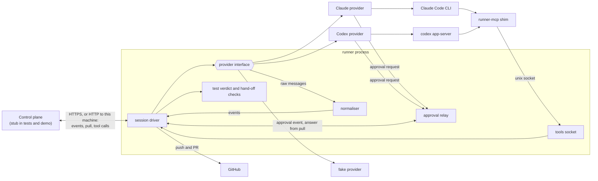

# agent-session-runner

A Python tool that runs a coding agent on a task while nobody is watching it. It drives Claude Code or Codex through one interface, keeps the session inside a sandbox, asks a person before the agent does anything outside its permissions, checks what the agent says about its own work, and hands the result over as a pull request.

I'm Warren Vogel. I use coding agents every day, and I built this so I could give one a task from my desk or my phone and come back to something I can review. That only works if it is safe to leave running. An agent misled by a web page or a repository should at worst waste one bounded, sandboxed session that I will see. The design is mine, worked out hand in hand with a coding agent, and coding agents wrote most of the code under my rules and review. It runs on my home lab, and I am its only user.

## What it does

- **Runs either vendor's agent the same way.** Claude Code, through the Claude Agent SDK, and Codex, through its app-server SDK, sit behind one provider interface. Their messages become one event stream, so a session looks the same to whatever is watching whichever agent runs it.
- **Keeps a person in the loop.** A tool call outside a session's permissions waits for an approval that is relayed to me, and silence is a denial. I can queue a message for the next turn, steer the current one or interrupt it.
- **Checks the agent's claim that the tests passed.** The runner has the agent run the project's test command as a last turn, then reads the result from the tool's own record of that command. What the agent says about it is a claim to check.
- **Hands the work over for review.** A finished coding session is pushed to a branch and opened as a pull request. Its description carries the agent's own summary and whatever the runner found wrong with it.
- **Gives agents my task tracker through an MCP server I built.** It is a small stdio server with a pinned catalogue of thirteen tools, and the control plane enforces each session's scope. [`docs/design.md`](docs/design.md) lists the tools.
- **Treats the model and the repository as untrusted.** Sessions run inside the vendors' sandboxes, held to their own worktree, and the runner refuses to start Claude Code unless the machine's managed settings file requires the sandbox. Agent settings come from me and never from files in the checkout. Every session starts from one short, versioned set of house rules.

## See it work

You need [uv](https://docs.astral.sh/uv/) and Python 3.13 (`uv python install 3.13` if uv does not find one). You need no credentials, and no network access after the install.

```sh
uv sync --frozen
uv run --frozen pytest -q
uv run --frozen python -m runner.demo
```

The tests use loopback and unix sockets. On macOS with uv 0.13.6 and Python 3.13.6 the suite gave 1098 passed, 0 failed, 0 skipped. The hosted checks run the suite and the demo on Linux and macOS.

The demo does two things. First it replays recordings of real Claude Code and Codex sessions through the runner and prints the one event stream that comes out. Then it runs a whole session in which the agent says the tests passed while the recorded tool output says they failed. These are its last lines:

```text
The model's claim in its typed result: {"command": "uv run pytest -q", "status": "passed"}
The runner's verdict, read from the recorded tool result: Tests failed with exit code 1: `uv run pytest -q`.
Hand-off finding tests_claim_failed: The session reports that tests passed, but the runner recorded a failed final test check.
```

The agent's claim is kept as evidence, the verdict comes from the tool record, and the mismatch goes to the reviewer with the hand-off. That second session is scripted: a fake provider plays the agent, and the real runner code handles it. It shows what the runner does with the contradiction. It does not measure how often a live agent misreports.

## What this edition is

This is the runner component of a larger personal system, cut from my home lab so that it can be read and tested on its own. It is orchestration on the vendors' SDKs and command-line tools, not a framework of its own.

- **What is not here:** the control plane, which holds the console, the tracker and the session queue, and the per-machine launcher and deployment scripts. A stub control plane stands in for the tests and the demo. This is not a complete installation of my system.
- **What needs a vendor login:** the two real providers. The tests import and construct them and never start a live session.
- **What does the enforcing:** each vendor's sandbox enforces the read, write and network limits. The runner writes the rules, checks the machine's managed settings file before Claude Code starts and refuses when that file does not require the sandbox. [`docs/security-model.md`](docs/security-model.md) lists what each side covers.
- **What it is pinned to:** `claude-agent-sdk==0.2.180` (bundling Claude Code CLI 2.1.321) and `openai-codex==0.167.0` (with `openai-codex-cli-bin` 0.167.0). Several rules depend on how those exact versions behave.
- **What its checks are:** deterministic checks on one session's outcome. It is not an evaluation framework or a benchmark.

## Architecture



## Read the code by question

1. **How do two vendors' messages become one usable event stream?** [`runner/normalise.py`](runner/normalise.py), checked against recordings of real sessions in [`tests/fixtures/`](tests/fixtures) by [`tests/test_normalise.py`](tests/test_normalise.py). The interface both providers implement is [`runner/providers/base.py`](runner/providers/base.py), and the two real implementations are [`claude.py`](runner/providers/claude.py) and [`codex.py`](runner/providers/codex.py).
2. **What evidence is enough to report a test result?** [`runner/testrun.py`](runner/testrun.py) and [`tests/test_testrun.py`](tests/test_testrun.py). Start with `test_verdict_requires_the_exact_project_command_and_worktree_evidence` and `test_the_runner_never_runs_the_command`. [`runner/handoff_check.py`](runner/handoff_check.py) then compares the model's own claim with the verdict.
3. **How do approvals and permissions cross between the runner and a provider?** [`runner/relay.py`](runner/relay.py) turns a provider's request into an event and waits for my answer. [`runner/refusals.py`](runner/refusals.py) holds the requests that are refused without asking. The tests are in [`tests/test_session.py`](tests/test_session.py), such as `test_silence_denies_at_the_ceiling`, and [`tests/test_refusals.py`](tests/test_refusals.py).
4. **How does an agent reach a tool outside its session?** The MCP bridge: [`runner/mcp_shim.py`](runner/mcp_shim.py), [`runner/session_socket.py`](runner/session_socket.py) and [`runner/mcp_tools.py`](runner/mcp_tools.py), with [`tests/test_mcp_shim.py`](tests/test_mcp_shim.py).

Then [`docs/design.md`](docs/design.md) for how a session runs and [`docs/security-model.md`](docs/security-model.md) for the controls.

## How it was built

Coding agents wrote most of this code under my rules and review. About 80% of the commits in the repository this runner came from carry an agent co-author trailer (792 of 993 when this edition was cut). That figure counts commits across the whole of that repository, not lines of the runner. This edition is a cut of the original runner with names neutralised and comments rewritten.

See [`NOTICE.md`](NOTICE.md). All rights are reserved pending the owner's choice of licence.
